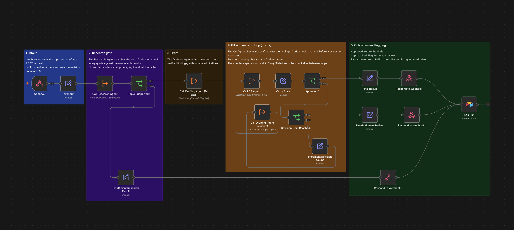
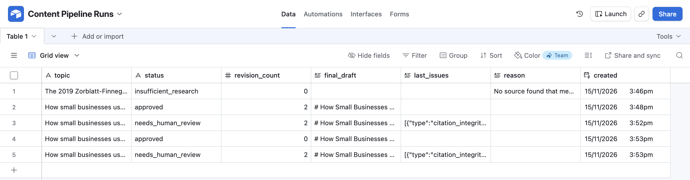

# Multi-Agent Content Pipeline

A content pipeline that shows its working. Three AI agents (research, drafting and QA) check each other, code verifies anything code can verify, and a person gets anything the system can't resolve. Built in n8n with OpenAI, Tavily and Airtable.

**Demo video:** [Watch the demo](https://www.loom.com/share/4a99b33d59d2493a883c270e3319bcdb)



## Highlights

- **Verification lives in code, not in prompts.** In testing, the research agent invented evidence even with strict instructions. Code now checks every quote against the raw search results and drops anything it can't find.
- **A hard cap on revisions.** A draft that fails QA goes back to the drafter up to twice, then goes to a person with QA's feedback attached. Two of four real-topic test runs escalated this way.
- **Honest failure paths.** Given a topic that doesn't exist, it declines to write and says why.
- **Every run is logged** to Airtable with its status, revision count and draft.

## What I built

A webhook receives a topic and a brief. A research agent searches the web and returns structured findings, and code verifies each quote. If nothing survives, the run stops. A drafting agent writes only from the verified findings. A QA agent reviews the draft against those findings, and code enforces one check the model kept missing: every cited source must appear in the References. If the draft fails, it loops back for a revision, capped at two, and then goes to a person. Every outcome returns JSON to the caller and is logged.

It is four n8n workflows:

| Workflow | Job | Returns |
|---|---|---|
| Orchestrator - Content Pipeline | Fixed sequence, branching, revision cap, HTTP response, logging (plain nodes, no LLM) | JSON with status and draft |
| Agent - Research | Web search (Tavily), then code verification of every quote | Verified findings, gaps, confidence, topic_supported |
| Agent - Drafting | Writes only from the findings, with no tools | Draft with numbered citations, sources_used, blocked_reason |
| Agent - QA | Model reviews the draft against the findings, then code checks the References | approved, issues, revision_notes |

## Design decisions

1. **Sub-workflows instead of one big canvas.** Each agent is its own workflow with defined inputs and outputs, so I could test it alone and swap it without touching the rest. n8n's AI Agent Tool node would have kept everything on one canvas, which is quicker to prototype but harder to test in isolation.
2. **Plain nodes for the orchestration.** The sequence, the branching and the revision cap are IF nodes and a counter, not a model's decision. A rule like "stop after two tries" shouldn't depend on a model following instructions.
3. **Narrow scope for each agent.** The researcher can search but not write. The drafter has no tools. QA reviews but doesn't rewrite.
4. **Structured outputs everywhere.** Each agent returns JSON checked against a schema, with an auto-fix parser as a safety net. It repairs format, not truthfulness.
5. **A way to say "I can't".** Agents have fields for it (topic_supported, gaps, blocked_reason). Without one, a model fills the gap with something plausible.
6. **The rule I ended up with:** prompts request behaviour, schemas constrain shape, code verifies facts.

## What broke, and what I did about it

| What I found | How I found it | Fix |
|---|---|---|
| The researcher presented a made-up protocol as real and cited an unrelated page | Deliberate nonsense-topic test | Added topic_supported, a verbatim-evidence field and stricter rules |
| Prompt rules were not enough: some quoted 'evidence' was not in the search results (2 of 5 findings in one run, 4 of 5 in another) | Compared quotes with the raw results | Code checks every quote and URL against the raw search results and drops anything it cannot find |
| QA approved a draft with no References section, inconsistently across runs | Same input, different verdicts | Moved the check into code: every cited URL must appear in the draft text |
| QA listed passed checks as issues and misfiled the real one | Read the issues array | Tightened the schema rules, with the code check as the backstop |
| The drafter claimed changes it had not made and rewrote more than asked, through three prompt revisions | Diffed drafts against the revision notes | Stopped tuning and documented it as a known limit |
| Revision loop never ended | Canvas showed 5+ passes | Sub-workflow nodes drop extra fields, so the counter reset each pass. Added a Carry State step |
| Escalated runs logged one revision too few | Airtable log, not the canvas | Removed an extra +1 in the cap condition |
| Human-review output showed stale or empty data | Inspected the logged row | Switched node references to the latest run and read from the incoming item |

**QA false positives.** QA rejected a source dated May 2026 as a future date. Giving it today's date did not fix that: it quoted the date back and still compared it wrongly, then complained about recency instead. The fix has three layers: a rule telling QA not to judge dates, today's date removed from its prompt, and a code filter that drops date and recency complaints that mention a year when no date is later than today. After the filter, 0 of 5 runs of a date-sensitive test draft flagged the date. One run raised a different false positive (it counted citation markers from 0 instead of 1), which I fixed by stating that numbering starts at 1. I then re-ran the date test, the missing-References test and a production run, and all behaved as expected. The filter only catches complaints that mention a year, so other wordings could still get through.

**Reliability.** The drafting and QA agents each failed intermittently with a model-output format error, and one run hit a provider outage. Fixes: retry on fail on the agent nodes, auto-fix on every output parser, and a looser QA schema (issue type as free text, quoted text optional). After these changes each agent passed 5 of 5 standalone runs, and all 5 production runs of the full pipeline completed without an error.

## What the runs showed

Tested on a local n8n instance through the production webhook: four runs of the real request and one run of a made-up topic, all logged in Airtable. This is a small sample, not a benchmark.

| Outcome | Runs (of 5) | What happened |
|---|---|---|
| Approved | 2 | One passed on the first draft. The other was approved only after two revisions, so the loop did repair it |
| Needs human review | 2 | QA still rejected the draft after two revisions, so it was flagged with the feedback attached. Both included a brief-coverage issue: the research did not support the risks half of the brief |
| Insufficient research | 1 | The made-up topic: no source mentioned it, so the research gate stopped the run before any drafting |



- All five runs completed without an error, and each one was logged with a matching status.
- Three of the four real-topic runs went through two revisions. One was then approved and two escalated. The revision cap held every time: no run went past two.
- Reading the full issue lists, both escalations included a brief-coverage issue: the research returned little on risks (in one run it produced a single verified finding), and the drafter is not allowed to invent content, so revisions could not fix it. One run also contained a QA false positive: QA rejected a source dated May 2026 as a future date. At that point it did not have the current date, and when I supplied it the model still misjudged dates, so I now filter these complaints in code.
- Live search returns different sources each time, so outcomes vary. In an earlier rehearsal set, one real-topic run stopped at the research gate because all five findings failed citation verification.
- Earlier rehearsal runs took between about 15 seconds and 1 minute 6 seconds, and the slowest were the ones that went through two revisions.

Real responses from these runs are in `examples/`.

## What it can't do yet

- On revisions, the drafter can rewrite more than the reviewer asked for, and its change log is self-reported.
- QA's catch rate on subtle factual overstatement is probabilistic. One worked example in the prompt improved it, but it is not guaranteed.
- Two of four real-topic production runs escalated to human review, and a third was only approved after two revisions. The issue lists point to two causes. When the research is thin, the brief's risk section cannot be supported from the findings, and the revision loop sends feedback only to the drafter, never back to research. QA can also be wrong: it rejected a recent source as a future date, and later as unverifiable, even when given today's date. A rule and a code filter now remove those complaints, but the filter only catches wordings that mention a year, so other phrasings could still get through.
- The research gate passes with a single verified finding, so a borderline topic can pass on one run and fail on the next.
- On a second revision, the drafter's baseline is still the first-pass draft.
- Intermittent model-format and provider errors occurred before retries and auto-fix were added. They are mitigated, not eliminated.
- The webhook responds synchronously (about 15 seconds to over a minute). There is no error workflow, so a crash mid-run returns an error and is not logged.

## What I'd add for a client

- Return a job ID immediately and deliver the result by callback.
- An error-trigger workflow with alerts, and a Slack or email notification on human-review cases.
- Require at least two verified findings before the research gate passes, send coverage problems back to research instead of the drafter, and move more of QA's checks into code, as I did for the References check and for dates.
- A fixed evaluation set of topics, re-run after every change, to track pass rate.
- Cost per run tracked in the log, plus webhook authentication and a hosted n8n instance.

<details>
<summary><b>Run it yourself (optional)</b></summary>

&nbsp;

You need n8n, an OpenAI key, a Tavily key and an Airtable base.

1. Import the four workflow files from `workflows/`.
2. Create credentials for OpenAI, Tavily and Airtable, and re-select your Airtable base and table in the Log Run node.
3. Point each Execute Sub-workflow node at the matching imported workflow.
4. Publish the three agent workflows first, then the orchestrator.
5. Send a request (also saved as `examples/request-approved.sh`):

```
curl -X POST http://localhost:5678/webhook/content-pipeline -H 'Content-Type: application/json' -d '{"topic":"How small businesses use AI for invoice processing","brief":"Audience: non-technical small business owners. Angle: practical benefits and risks. Need current, verifiable info."}'
```

`examples/request-fake-topic.sh` sends a topic that doesn't exist, so you can watch the research gate decline it.

The Airtable table has these fields:

| Field | Type |
|---|---|
| topic | Single line text (primary field) |
| status | Single line text (approved, needs_human_review or insufficient_research) |
| revision_count | Number (0 decimal places) |
| final_draft | Long text |
| last_issues | Long text |
| reason | Long text |
| created | Created time |

</details>
